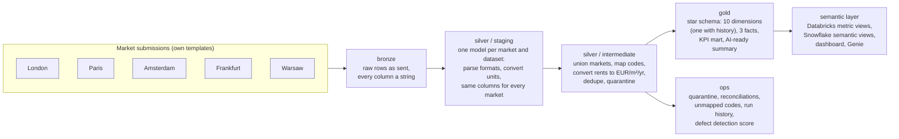
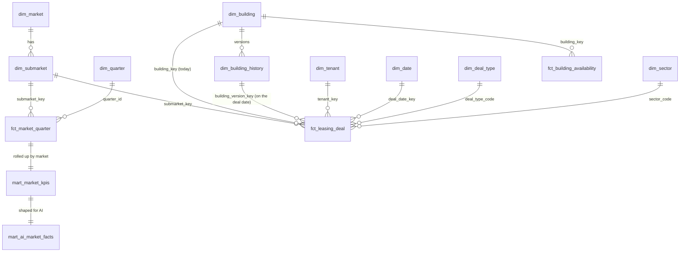
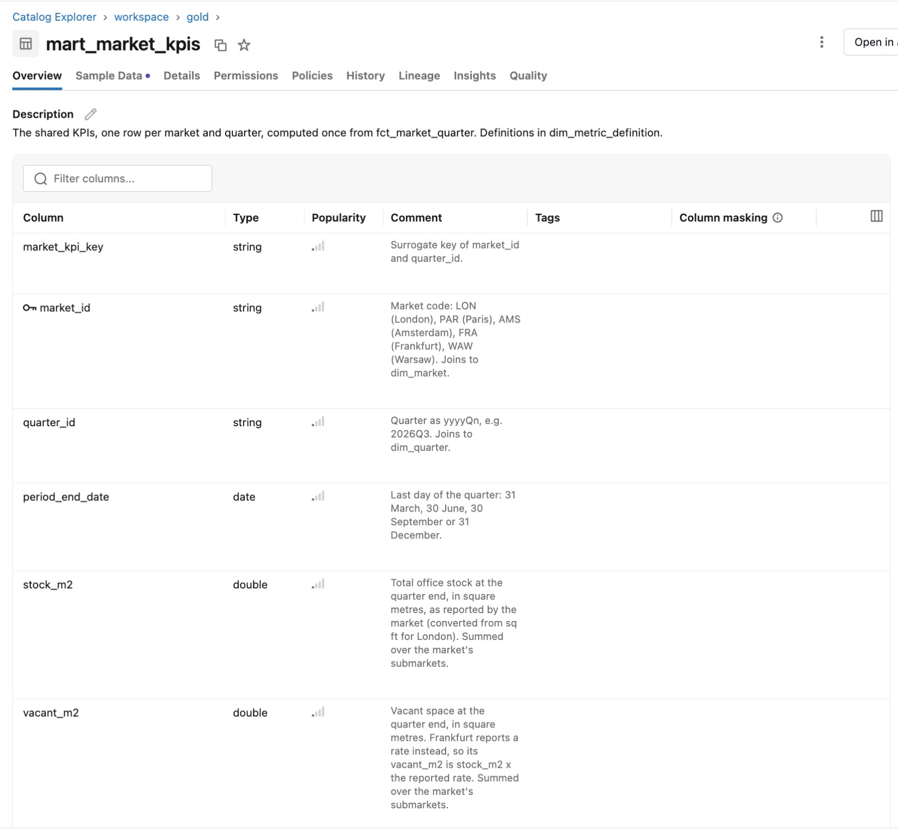
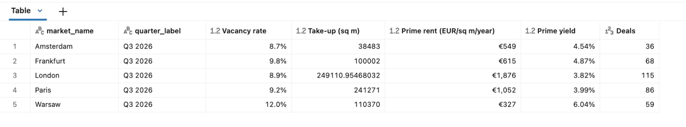

# EMEA Office Market Lakehouse

Five office markets, five ways of reporting the same things, one tested and documented data
foundation. A dbt project that onboards each market's quarterly research submissions (market
statistics, leasing deals, building register, availability) in whatever template the market uses,
standardises them once in a medallion pipeline, and serves a star schema, a shared KPI layer and a
semantic layer (Databricks metric views, Snowflake semantic views) on top. One set of SQL for three
engines: DuckDB, Databricks and Snowflake.

> **All data is synthetic.** The five markets, their submarkets, buildings, tenants and figures are
> generated from documented assumptions to exercise the pipeline. The levels are plausible for 2026
> office markets but are not market data. Nothing here describes any real company or property.

[](https://github.com/michaelsamuel2005/emea-market-lakehouse/actions/workflows/ci.yml)

## Where it has run

| Engine | How | Status |
| --- | --- | --- |
| DuckDB 2.0 | `dbt build`, locally and in CI | Builds and passes on every push |
| Apache Spark 4.0, ANSI mode (the Databricks SQL dialect) | CI, dbt-spark in-process ([`scripts/engines/`](scripts/engines/README.md)) | Builds and passes on every push; every table identical to the DuckDB build |
| Snowflake SQL on the fakesnow emulator | CI, the real dbt-snowflake adapter | Builds and passes on every push (unit tests and comments excluded); every table identical to the DuckDB build |
| Databricks Free Edition | [`databricks/RUNBOOK.md`](databricks/RUNBOOK.md) | Built 5 Nov 2026: 431 pass, 2 warnings (as DuckDB); metric views created and queried |
| Snowflake trial account | [`snowflake/RUNBOOK.md`](snowflake/RUNBOOK.md) | Not yet run on an account |
| Power BI Desktop on the Databricks warehouse | [`powerbi/README.md`](powerbi/README.md) | Not yet built |

The last three rows change only when the guide has been followed for real; each run is recorded there
with its date and anything that had to change.

## The problem it solves

Each market reports in its own way:

| Market | Area unit | Rent convention | Quarter written as | Numbers written as | Vacancy reported as | Deal log |
| --- | --- | --- | --- | --- | --- | --- |
| London | sq ft | GBP per sq ft per year | `Q3 2026` | `86,111,283` | vacant area | English |
| Paris | m² | EUR per m² per year | `T3 2026` | `7 000 000` / `1 050,00` / `4,38 %` | vacant area | French labels |
| Amsterdam | m² | EUR per m² per year | `2026-Q3` | `1200000` | vacant area | English |
| Frankfurt | m² | EUR per m² per **month** | `3. Quartal 2026` | `1.600.000` / `50,00` | a **rate** (%) | German labels |
| Warsaw | m² | EUR per m² per month, some deals in **PLN** | `2026Q3` | `1600000` / yields as `0.0625` | vacant area | English |

A BI team that wants one vacancy chart, one prime-rent league table and one definition of take-up
has to resolve all of that once, in one place, and prove it. That is what this project does.

## What it does



- **Onboarding a market is configuration.** Each market's conventions and column names live in one
  block of `dbt_project.yml`; the four staging models for a market are one-line macro calls. A new
  market needs that block, its raw files, its code mappings and `scripts/scaffold_market.py`.
  The Madrid files in `exercise/madrid/` are there to prove it: see [docs/onboarding_a_market.md](docs/onboarding_a_market.md).
- **Business logic is defined once.** Unit and currency conversion, code mapping, deduplication and
  the plausibility checks happen in silver, for every market, with the same macros. KPI definitions
  are computed once in `gold.mart_market_kpis` and written down in
  [`ref_metric_definitions`](seeds/reference/ref_metric_definitions.csv), which is also a gold table and
  the Genie space's instructions.
- **The rules are unit-tested.** Eight dbt unit tests feed fixed rows to the logic and check the exact
  output: each market's number and date formats, the quarantine and repair rules, the stock-weighted
  vacancy rate, rolling and year-on-year KPIs, and the building history. Break a rule on purpose
  (Frankfurt's `rate_format`, the rolling window, the area check) and the matching test fails.
- **Nothing broken reaches gold silently.** 340 data tests run on every build. Most are basic: 200
  not-null checks, 28 unique and 22 relationship checks on keys. The ones that carry the logic are the
  eight singular checks (FX coverage, every quarter reported, the KPI mart adds up to the fact, no
  unmapped codes, quarantine rate under 5%, the building history has no gaps or overlaps), the range
  checks, and two reconciliations that compare what a market reports with what the lakehouse can
  compute from its own detail: vacancy against the building register, take-up against the deal log.
- **History where it matters.** A refurbished building changes grade. Buildings are a type 2 slowly
  changing dimension built from the markets' own register dates, and each deal points at the building
  as it was when the lease was signed: 128 deals were signed in buildings that were Grade B or C at the
  time and are Grade A now.
- **The checks are scored.** The generator logs every defect it plants (duplicates, resubmissions,
  monthly rents typed into annual files, areas in the wrong unit, future dates, blank submarkets).
  `ops.ops_defect_detection` reports how many the pipeline caught. The misses are documented below.
- **Performance is monitored and the models are tuned.** An `on-run-end` hook appends every node's
  status, timing and row count to `ops.dbt_run_results`; `ops.ops_runtime_alerts` flags anything that
  failed or took more than twice its usual time. On Databricks the facts are liquid-clustered by the
  keys every query filters on, and `databricks/maintenance.sql` holds the weekly OPTIMIZE / ANALYZE /
  VACUUM. [`docs/performance.md`](docs/performance.md) explains each decision.
- **One codebase, three engines.** The few functions DuckDB, Databricks and Snowflake spell differently
  are in [`macros/cross_db.sql`](macros/cross_db.sql), dispatched by adapter; no model contains an engine
  check. CI builds the project on Spark in ANSI mode and through dbt-snowflake on an emulator, and
  compares every table with DuckDB's ([`scripts/engines/`](scripts/engines/README.md)).
- **AI-ready.** `gold.mart_ai_market_facts` carries unit-suffixed columns and a plain-language
  summary per market-quarter; every gold column is documented (a test enforces it) and written to the
  warehouse as a comment; the metric views and semantic views carry descriptions, formats and
  synonyms; the Genie instructions in `databricks/genie/` turn the definitions into answers.

## Results

<!-- RESULTS:START -->
From `dbt build` on the committed data (`python scripts/fact_sheet.py` reproduces every figure):

| | |
| --- | ---: |
| Markets, submarkets, quarters | 5, 24, 15 (2023Q1 to 2026Q3) |
| Bronze rows loaded, as sent | 14,762 |
| Deal rows submitted → in gold | 5,797 → 5,608 |
| Held back by silver checks | 189 (169 duplicate submissions, 11 dated after their submission, 9 impossible areas) |
| Repaired rather than dropped | 84 blank submarkets filled from the building register; 28 implausible rents suppressed, deals kept |
| Buildings, tenants | 720 buildings in 750 versions (30 re-sent after a refurbishment); 299 tenants, 17 active in more than one market |
| Building history | 207 deals signed in a building the market later re-sent; 128 of them in a lower grade than the building has now |
| Tests | 348: 8 unit tests and 340 data tests (200 not_null, 37 accepted_values, 28 unique, 22 relationships, 16 range, 15 positive, 13 composite key, 8 singular, 1 distinct count). All pass; 2 warnings by design (below) |

**Detection against the answer key** (`ops.ops_defect_detection`): exact duplicates 100%, near
duplicates with the tenant spelt differently 100%, deals dated after submission 100%, monthly rents
in annual files and the reverse 100%, blank submarkets repaired 100%, withheld rents correctly left
alone 100%, areas typed in the wrong unit **41%**. Zero false positives: every held-back row is a
planted defect.

**The 41% is the honest gap.** An area typed in m² into London's sq ft file is 10.76× too small
after conversion, and a 1,900 m² deal that reads as 177 m² still looks like a real small deal.
The reverse error (sq ft typed into a m² file) is caught when it exceeds the building's size.
The take-up reconciliation then points at the rest: the eight submarket-quarters where logged deals
exceed reported take-up by 11% to 68% are exactly where the undetected oversized rows sit. A rule
comparing a tenant's deal with its previous deals, or a minimum plausible deal size per market, is
the next improvement.

**Reconciliations.** Reported vacancy agrees with the building register within 0.29 percentage points
on average across 360 submarket-quarters; the one breach of the 2 pp tolerance (Warsaw CBD, 2024Q1,
−4.5 pp) is the planted mismatch, flagged as a warning for the market to explain. Reported take-up
agrees with the deal log within 10% in 346 of 360 submarket-quarters.

**Latest quarter (2026Q3), market level, from `gold.mart_market_kpis`:**

| Market | Vacancy rate | Take-up (m²) | Prime rent (EUR/m²/yr) | Prime yield | Deals |
| --- | ---: | ---: | ---: | ---: | ---: |
| Amsterdam | 8.7% | 38,483 | 549 | 4.54% | 36 |
| Frankfurt | 9.8% | 100,002 | 615 | 4.87% | 68 |
| London | 8.9% | 249,111 | 1,876 | 3.82% | 115 |
| Paris | 9.2% | 241,271 | 1,052 | 3.99% | 86 |
| Warsaw | 12.0% | 110,370 | 327 | 6.04% | 59 |

London's prime rent is £150 per sq ft per year in its own file; Frankfurt's is €50 per m² per month.
Both are compared here in EUR per m² per year because silver converted them once, with that quarter's FX rate.
<!-- RESULTS:END -->

## The model

Silver produces one conformed table per dataset; gold is a star schema.



| Table | Grain | What it holds |
| --- | --- | --- |
| `fct_market_quarter` | market × submarket × quarter | Reported stock, vacancy, take-up, prime rent (EUR/m²/yr and local), prime yield, pipeline; bottom-up vacancy from the register; deal counts and achieved rent from the log |
| `fct_leasing_deal` | one deal | Area, rent in EUR/m²/yr and as reported, term, type, sector, tenant, the building today and the building version on the deal date; only deals that passed every check |
| `dim_building_history` | building × version | Each building as it was between `valid_from` and `valid_to` (type 2): grade, area, refurbishment year |
| `fct_building_availability` | building × quarter | Available and sublease space in each tracked building |
| `mart_market_kpis` | market × quarter | The 15 shared KPIs: vacancy rate, take-up (quarter, YTD, rolling 4Q), net absorption, prime rent and growth, prime yield, pipeline rate, register vacancy, deal statistics |
| `mart_ai_market_facts` | market × quarter | The same KPIs with unit-suffixed names and a summary sentence |
| `dim_metric_definition` | one KPI | Name, gold column, definition, unit, formula, grain, owner |

[`docs/architecture.md`](docs/architecture.md) walks through each layer; [`docs/data_contract.md`](docs/data_contract.md)
is the contract for gold; [`docs/naming_standards.md`](docs/naming_standards.md) is what reviewers check;
[`docs/request_to_model_examples.md`](docs/request_to_model_examples.md) walks through seven requests a
Research or BI team might send and where the model answers each.

## On Databricks and Snowflake

[`databricks/RUNBOOK.md`](databricks/RUNBOOK.md) runs the project in a Databricks Free Edition workspace
(`dbt build --target databricks` with an OAuth sign-in, or `--target databricks_token` with a personal access
token), then adds the platform layer: two Unity Catalog metric views (`databricks/metric_views/`), an AI/BI
dashboard (`databricks/dashboard/tiles.sql`), a Genie space with instructions, example queries and benchmark
questions (`databricks/genie/`), and a notebook that lands the raw files from a Volume with `COPY INTO`.

[`snowflake/RUNBOOK.md`](snowflake/RUNBOOK.md) runs the same project on a Snowflake trial account
(`dbt build --target snowflake`, key-pair authentication): `snowflake/setup.sql` creates the warehouse, role,
database and a credit quota, and two semantic views (`snowflake/semantic_views/`) define the same KPIs for
Cortex Analyst. No secret is stored in the repository for either platform; `profiles.yml` reads environment
variables (`.env.example`).

**Power BI.** [`powerbi/README.md`](powerbi/README.md) builds the report a BI developer would build on this
gold layer, connected to the Databricks SQL warehouse: a star-schema model with single-direction
relationships, the measures in [`powerbi/measures.dax`](powerbi/measures.dax) (ratios from sums, prime rent
as the best submarket, growth read from the KPI mart, and a check measure that shows the fact and the mart
agree), a market overview page and a leasing deals page that reports each deal against the grade its
building had on the deal date.




<!-- Add after running each runbook:


-->

## Run it

Python 3.11 or later. Everything is pinned in `requirements.txt`.

```bash
python3 -m venv .venv && source .venv/bin/activate
pip install -r requirements.txt
dbt build                     # DuckDB: 31 seeds, 53 models, 340 data tests and 8 unit tests, about 20 seconds
dbt test --select test_type:unit   # just the unit tests
dbt docs generate && dbt docs serve
python scripts/monitor.py     # slowest nodes and anything not green from the last run
python scripts/fact_sheet.py  # the numbers above, from the database
pytest tests_py               # generator invariants, pipeline checks, documentation coverage
sqlfluff lint models tests analyses
```

On Databricks or Snowflake: `pip install -r requirements-databricks.txt` (or `requirements-snowflake.txt`)
and follow the runbook. The Spark and emulator checks CI runs are in
[`scripts/engines/README.md`](scripts/engines/README.md).

`python generator/generate.py` regenerates the raw files from `generator/assumptions.yaml`
(`--check` verifies the committed files match, which CI does on every push).

## Project structure

```
dbt_project.yml          layers, tests config, and the per-market onboarding configuration (vars.markets)
profiles.yml             duckdb (default), databricks, snowflake, and the CI-only spark and snowflake_emulator targets; no secrets
requirements*.txt        pinned: core (DuckDB), -databricks, -snowflake, -engines (CI's Spark and emulator checks)
generator/               generate.py, assumptions.yaml, answer_key/ (every planted defect, truth tables, fact sheet)
seeds/bronze/            the raw files, one per market and dataset, loaded as strings
seeds/reference/         markets, submarkets, FX rates, code mappings, KPI definitions
seeds/answer_key/        the defect log as a seed, for ops.ops_defect_detection
models/bronze/           sources.yml (generated; freshness on the submission timestamp)
models/silver/staging/   stg_<market>__<dataset>: one-line macro calls, same columns everywhere
models/silver/intermediate/  int_*_unioned views, then int_*: map, convert, dedupe, quarantine, building versions
models/silver/_unit_tests.yml, models/gold/_unit_tests.yml   dbt unit tests for the parsing, the checks, the KPIs and the history
models/gold/             dim_*, fct_*, mart_*; every column described in _gold.yml (shared descriptions in docs/dbt/columns.md)
models/ops/              quarantine summary, reconciliations, unmapped codes, defect detection, run history, alerts
macros/                  parse.sql (parsing, conversion), cross_db.sql (the engine differences), stage_*.sql, union_markets, store_run_results, generic tests
tests/                   singular tests (reconciliations, FX coverage, completeness, KPI adds up, no unmapped codes, building history tiles time)
databricks/              RUNBOOK, metric views, dashboard tiles, Genie instructions and queries, landing notebook, maintenance SQL
snowflake/               RUNBOOK, setup.sql (warehouse, role, database, credit quota), semantic views, dashboard queries
powerbi/                 the report build guide (model, relationships, pages) and its DAX measures
docs/                    architecture, data contract, naming standards, onboarding playbook, performance, request examples, AI readiness, real-data extension
exercise/madrid/         a sixth market's raw files and reference rows, for the onboarding exercise
scripts/                 preflight.py (check a target's variables, then dbt debug), scaffold_market.py, monitor.py, fact_sheet.py; engines/: the Spark and Snowflake-emulator runners and the table comparison
tests_py/                pytest: generator invariants, end-to-end checks on the DuckDB build, documentation coverage
.github/                 CI (generate --check, dbt build, freshness, lint, pytest, docs; then Spark, emulator and adapter compiles), PR template, CODEOWNERS
```

## Limitations

- The data is synthetic, and so are the markets' mistakes. The defect rates in `generator/assumptions.yaml`
  are guesses about how often a resubmission or a unit slip happens; real submissions will have problems
  this generator did not think of.
- Wrong-unit areas that still look plausible are not caught at row level (41% detection). The
  reconciliation surfaces them at submarket level; a row-level rule is the next step.
- FX rates are synthetic. [`docs/extension_real_data.md`](docs/extension_real_data.md) replaces them with ECB
  reference rates and adds a real building stock source.
- Not yet run on a real Databricks workspace or Snowflake account (see "Where it has run"). CI checks
  the two dialects with stand-ins: Spark is not Databricks (no Unity Catalog, Delta or metric views),
  and fakesnow is not Snowflake.
- Metric views, semantic views, Genie and dashboards are created from the files in `databricks/` and
  `snowflake/` by hand; they are not deployed by dbt.
- Surrogate keys are md5 hashes of text. A key built from a timestamp differs between engines because
  Snowflake prints timestamps with milliseconds; the rows are the same, the hashes are not.

## About

Built by Michael Samuel. Every number in this README comes from the pipeline
(`scripts/fact_sheet.py`), the rules are pinned down by unit tests, and the detection rates are scored
against the generator's own log rather than asserted.
